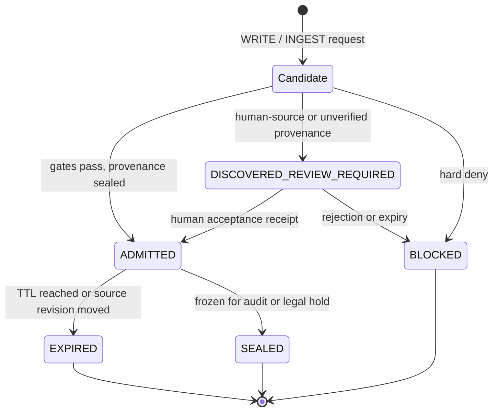
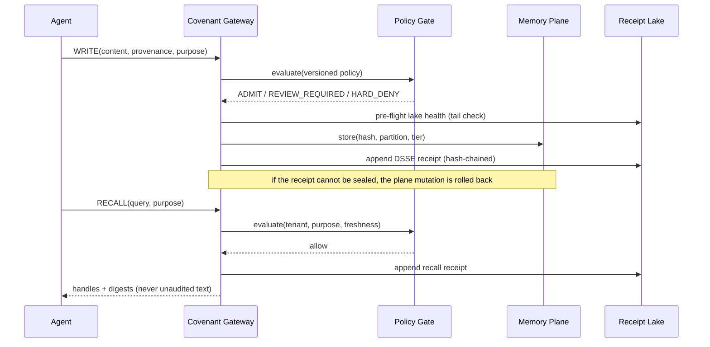

<!-- szl:header v1 -->
<!-- Native identity: szl-brand@4309f6fce89179331b0b3ed8c99494e76c5be256; Orbit v2 icon. -->
<p>
  <a href="https://github.com/szl-holdings">
    
  </a>
</p>

**Control before action. Evidence after.**

[Product](https://a-11-oy.com) · [Proof](https://a11oy.net) · [GitHub organization](https://github.com/szl-holdings)
<!-- /szl:header -->
# The Memory Covenant — Open Specification for Governed Agent Memory

**Version 0.4-draft** · Status: DRAFT · SZL Holdings (Doctrine v11) · Apache-2.0

## 1. The Invariant

> **No memory enters, leaves, or changes inside an agent's memory plane without identity, purpose, policy evaluation, provenance, lifecycle state, and a sealed receipt.**

Everything else in this specification is the machinery for making that sentence testable, the failure modes for making it honest, and the conformance levels for making it adoptable.

## 2. Scope

**In scope:** long-term and working memory of AI agents — memories, retrieved documents, summaries, skills acquired at runtime, continuous-learning artifacts, and any content later used to condition model behavior.

**Out of scope:** model weights, transient KV-cache, and classic RAG indexes that are never admitted to agent context. A plain search index may live outside the Covenant; the moment its rows enter an agent's context, they cross the boundary and covenant gates apply.

## 3. Terms and actors

| Term | Definition |
| --- | --- |
| **Principal** | The accountable human or organization that owns the agent |
| **Agent** | Any process that reads or writes the memory plane |
| **Memory Plane** | The store the Covenant wraps (e.g., Mem0, Zep, Letta, LangMem, custom) |
| **Covenant Gateway** | The fail-closed enforcement point; all operations pass through it |
| **Policy Gate** | Evaluates each operation against versioned, committed policy (Yuyay-13 class) |
| **Witness** | An independent signer that co-signs receipts (single-signer at C2; BFT 3-of-4 at C3) |
| **Verifier** | Any third party replaying the receipt chain offline |

## 4. Truth tiers

Every memory and receipt field carries exactly one tier. Never mix, never fabricate:

| Tier | Meaning |
| --- | --- |
| **MEASURED** | Observed directly from the primary source at runtime (bytes, digests, joules) |
| **REPORTED** | Claimed by a signed external source (provider signature verified) |
| **MODELED** | Derived by formula from measured/reported inputs |
| **UNAVAILABLE** | Unknown — and honestly marked. **UNAVAILABLE is a valid answer; a fabricated value is a covenant violation** |

## 5. Memory lifecycle



**Hard denies are absolute.** Recon-class, cross-tenant foreign-write, and weaponize-class content are denied at the gateway, and **no approval, credential, or model behavior can lift a hard deny**. Approval can move a DISCOVERED_REVIEW_REQUIRED item to ADMITTED; it can never move a BLOCKED item anywhere.

## 6. Operations and required receipts

| Operation | Semantics | Required receipt fields |
| --- | --- | --- |
| **WRITE** | Agent proposes a memory | Actor identity, purpose, policy gate verdict, provenance (source + digest or UNAVAILABLE), tier, lifecycle result |
| **RECALL** | Agent retrieves context | Query digest, policy verdict (tenant, purpose), returned handle digests — **recalls are receipted, not just writes** |
| **INGEST** | Bulk/continuous acquisition | Same as WRITE per item + ingestion contract identity; review-gated at higher levels |
| **ROUTE** | Memory crosses a boundary (tenant, model, device) | Source and destination identities, both policy verdicts |
| **EXPIRE** | Lifecycle removal | Original receipt digest, expiry cause (TTL / revision / policy) |
| **SEAL** | Freeze for audit | Original receipt digest, sealing witness set |

Every receipt is a DSSE envelope per governed-receipt-spec: canonical JSON payload, algorithm-declared digests, SHA3-256 hash chain over the lake, ECDSA-P256 signatures, cosign-compatible. Offline verification requires **no SZL software** — a dependency-free verifier is part of the open spec.

## 7. The write/recall flow



**Receipt-first staged commit.** The gateway never reports a memory as admitted before its receipt is sealed. The lake is pre-flighted (tail healthcheck) before the plane is touched; if receipt sealing then fails, the plane mutation is rolled back (adapters expose `remove()` for this) and the operation returns an honest failure. Adapters that cannot roll back must say so; the gateway reports `ROLLBACK_UNAVAILABLE` rather than pretending the write never happened. **Acceptance is fail-closed**: it re-verifies the backing content against the digest recorded at write time, re-evaluates the CURRENT policy against the CURRENT content (a stale verdict from write time is never trusted), and seals the Learning Receipt before the candidate enters the admitted set.

## 8. The Learning Receipt (review-gated continuous memory)

The Covenant's answer to self-improving agents:

1. An agent may **discover** candidate knowledge (continuous acquisition is encouraged).
2. Every candidate lands in DISCOVERED_REVIEW_REQUIRED at an exact source revision — **never directly in the serving corpus, never silently**.
3. A human-governed acceptance produces a signed **Learning Receipt**: who reviewed, what evidence, at which revision. Acceptance re-checks the current policy and the backing content at acceptance time.
4. Rejected or expired candidates expire with receipts; nothing is deleted without a trace.
5. **Continuous evidence acquisition, not silent model self-modification.** An agent that can rewrite its own memory without receipts is unauditable by construction; the Covenant makes self-improvement *reviewable* rather than forbidding it.

## 9. Conformance levels

See the repository README. Adopters climb levels; each is independently testable. **C2 is the recommended enterprise floor.**

## 10. Conformance test matrix

T1–T13 are implemented by `conformance/suite.py` (stdlib only, runs on a clean machine):

| # | Test | Expected |
| --- | --- | --- |
| T1 | WRITE that is hard-denied | Fails closed; no memory created |
| T2 | Receipt chain tamper (flip one byte in the lake) | Offline verifier reports the exact broken link |
| T3 | Fabricated MEASURED value with no primary source | Covenant violation; receipt records UNAVAILABLE or refuses |
| T4 | Hard-deny content with valid admin approval | **Still denied**; approval cannot lift a hard deny |
| T5 | Unreviewed candidate promoted to serving corpus | Fails closed; candidate remains DISCOVERED_REVIEW_REQUIRED |
| T6 | Cross-tenant ROUTE/RECALL without matching policy | Denied; tenant isolation holds |
| T7 | Offline verify of a full chain on a clean machine, no SZL software | Chain verifies end-to-end |
| T8 | Recall without a receipt | Fails closed; recalls are receipted |
| T9 | Policy hardened to hard-deny between write and acceptance | Acceptance refused; candidate demoted to BLOCKED; never served |
| T10 | Backing content altered or missing in the plane at acceptance | Acceptance refused; integrity break recorded |
| T11 | Receipt lake fails to seal on WRITE | Plane mutation rolled back; no memory without a receipt |
| T12 | Receipt lake fails to seal on LEARNING acceptance | Acceptance fails; candidate stays DISCOVERED_REVIEW_REQUIRED and never serves |
| T13 | Receipt lake fails to seal on a re-WRITE of already-admitted content | Admitted memory and its bytes are left intact; only a new mutation is rolled back |

## 11. Adapter interface (reference sketch)

```python
from covenant import CovenantGateway, Policy, ReceiptLake, Provenance
from adapters.in_memory import InMemoryPlane

gw = CovenantGateway(
    memory=InMemoryPlane(),                      # or Mem0Plane / ZepPlane / custom
    policy=Policy.load("policy-v3.json"),        # versioned, committed
    lake=ReceiptLake("lake/"),                   # hash-chained, append-only
    level="C2",
)

receipt = gw.write(actor=agent_id, content=text,
                   provenance=Provenance(url, digest, tier="MEASURED"),
                   purpose="support.customer_qa")

handles = gw.recall(actor=agent_id, query=q,
                    purpose="support.customer_qa")   # returns digests + receipt ids
```

## 12. Relationship to emerging standards

The Covenant is the **memory-plane realization** of what current standards drafts describe informationally: [Governance Audit Record (GAR) for Agentic AI](https://datatracker.ietf.org/doc/html/draft-sato-soos-gar-08) defines the audit record; [Agent Audit Trail](https://datatracker.ietf.org/doc/html/draft-sharif-agent-audit-trail/) defines a logging format; [Rule Provenance](https://datatracker.ietf.org/doc/html/draft-piehl-agent-rule-provenance-00) covers policy-rule lineage. All three become cryptographically enforceable when their records are DSSE envelopes in a hash-chained lake — which governed-receipt-spec already provides. The Covenant adds what none of them touch: **memory itself as the governed object**.

## 13. Spec governance

- Text and conformance suite: **Apache-2.0**, no field-of-use restrictions, patent covenant on implementing the spec as written.
- Reference implementation: the Memory Covenant v0.3 gateway in this repository (operational).
- Amendment: drafts proposed by receipted PR; breaking changes bump the major version; no silent edits — the spec obeys its own lifecycle states.

---

*Doctrine v11 · Control before action. Evidence after. Λ = Conjecture 1 (never a closed theorem).*
